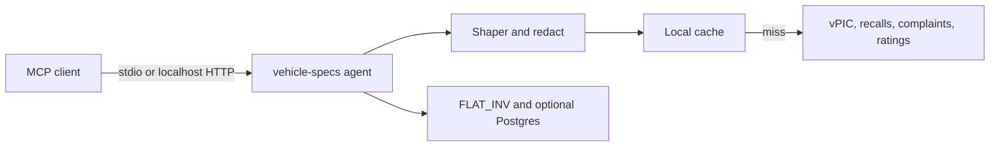

# Architecture

Design for the vehicle-specs agent. No code in this repo yet. Behavior that depends on a live NHTSA fact is cited in [research/nhtsa-data.md](research/nhtsa-data.md) or marked unknown. TTLs, tool names, and token budgets below are design choices.

## What the server is

A local MCP server. An MCP client starts it, the model calls a small set of tools, and the tools return short JSON that already embodies the rules a careful person would apply to NHTSA's raw responses. The model should not have to learn that empty means unknown, that recall dates are day-first, or that a 577 KB complaint file should have been a table of counts.

That is Context Engineering: decide the context, then let the model write. The server instructions, the tool descriptions, and the shaped payloads are the context. A prompt template is only one piece, and it is for the user to invoke, not a bag of hidden instructions.

## Tools

Seven tools. Names are proposals. They are not a wrap of each HTTP route. A route that dumps 12,000 makes, or 596 complaint narratives, is not a tool.

### `decode_vin`

One VIN. Optional model year.

Returns a compact object: the VIN we sent, `error_code`, `error_text`, and, when present, make, model, model year, trim, body class, vehicle type, doors, drive, engine (cylinders and displacement), fuel, plant country and city, and a short list of safety equipment that vPIC actually filled in (airbag locations, ESC, traction, TPMS). Drops empty strings and the value `Not Applicable`. If `include_raw_filled` is true, also return every remaining non-empty field. Default is false.

Always include NHTSA's sentence, paraphrased next to the fields: a missing value means NHTSA has no data, not that the equipment is absent. Carry `error_code` even when it is non-zero. HTTP 200 is not success. Observed codes are in the data inventory. We have not yet seen code `0`.

Does not call the extended endpoint unless `include_ncsa` is true. On the sample VIN the extended call added NCSA make, model, and body, and little else.

### `get_recalls`

Either `make` + `model` + `model_year`, or `campaign_number`. Not both.

Returns `count`, and up to 15 campaigns: campaign number, component, report date normalized to ISO `YYYY-MM-DD`, the do-not-drive and park-outside flags, the OTA flag, the linked investigation id when present, and a one-line summary clipped to 400 characters. `include_remedy` adds consequence and remedy, still clipped. The response says the date was converted from the day-first value NHTSA returned, and that a campaign is filed against the model string, not against a VIN's repair status.

If `count` is 0, add a notice: this spelling returned no rows. Other spellings may exist. Do not say "no recalls."

### `summarize_complaints`

`make`, `model`, `model_year`. Optional `component` substring.

Fetches the complaints API once, then reduces it before anything is cached or returned. Returns: `count`, date range of `dateComplaintFiled`, totals for crash, fire, injuries, and deaths, and the top components with those same totals. Default component list is 8, with the rest folded into `other`.

Drops `vin` and `summary` always in the default mode. `include_examples` may be 0 to 3. Each example is the component, the flags, the dates, and a summary clipped to 300 characters after a redaction pass that masks email-shaped strings, phone-shaped strings, and any token that looks like a VIN. Examples are off by default. The response states that narratives are consumer reports, not findings.

The Civic 2018 response was 576,788 bytes for 596 rows. The tool must not return that body. If the upstream count is large, the summary is still small. There is no paging parameter on this API. **Unknown** how big the largest model is. The shaper's memory budget should stream or cap the parse. A practical cap: if the body exceeds 8 MB, abort that section and return `unavailable` with the byte size, rather than risk the process. Eight megabytes was not observed. It is a guardrail.

### `get_safety_ratings`

Either `make` + `model` + `model_year`, or `vehicle_id`.

For a model, return the variant list (description and id). If there is exactly one variant, also return its ratings. For an id, return the star fields, the three driver-assistance fields NHTSA includes, and the embedded counts, each labeled as NHTSA's figures on the ratings record, not as a live recall or complaint query.

Preserve the string `Not Rated`. Do not coerce it to null or to zero. If the variant list is empty, say this model string has no NCAP row. The 2011 BMW X3 decode string did that.

### `search_investigations`

Local search over `FLAT_INV.zip`. Arguments: any of make, model, model year, component, and a free-text query on subject and summary. Optional NHTSA action number for one record.

Returns up to 20 rows, newest open date first: action number, make, model, year, component, opened, closed, subject, linked campaign number. Summary text only when a single id is requested, clipped to 1,000 characters. The response includes the file's `Last-Modified` date so the model can say how fresh the index is.

No live investigations API was found. This tool does not call `api.nhtsa.gov` for searches.

### `vehicle_profile`

The tool a model should call first. Input is a VIN, or make plus model plus model year. Optional model year alongside a VIN.

Steps:

1. If a VIN was given, `decode_vin`. Stop with the error object if the code says the VIN is incomplete or invalid and no make or model was produced. If make and model were produced alongside a warning (the check-digit case did this), continue and keep the warning.
2. `get_recalls`, `summarize_complaints`, and `get_safety_ratings` for the decoded make, model, and year. Investigations for the same triple.
3. Return one object with `identity`, `specs`, `recalls`, `complaints`, `ratings`, `investigations`, and `section_status`.

`section_status` is `ok`, `empty`, or `unavailable` per section. A timeout in complaints must not wipe the recalls. Empty ratings are `empty`, not `unavailable`. The profile repeats the two sentences the model needs: missing specs are unknown, and nothing here is a per-VIN repair status.

Variant mismatch: ratings may have several variants (the 2013 RDX had FWD and AWD). The profile lists them and does not pick one unless the decode's drive type clearly matches a single description. If it does not, return the list and leave the choice visible.

### `list_model_names`

`make` and `model_year`. Returns three lists, each tagged with its source: vPIC models for that make and year, distinct model strings from the products endpoint with `issueType=r`, and NCAP model strings. Duplicates removed. The products list is labeled incomplete. We observed it omit BMW X3 2011 while the recalls API returned four campaigns for that string, and we observed `modelYears` stop in the 1960s. This tool exists so a model can recover from an empty recall or rating search. It is not a proof of what exists.

`GetAllMakes` is not a tool. Twelve thousand makes and 616 KB will not fit in a context on purpose.

## Resources

Resources are for the client to read, not a second copy of the tools.

| URI | Contents |
| --- | --- |
| `nhtsa://about` | What the server will and will not claim. The missing-data rule, the repair-status rule, the Not Rated rule, and the link to NHTSA's terms. Kept short, under 500 words. |
| `nhtsa://coverage` | One table: source, years as documented, how fresh our cache or file is, and the quirks that change answers. |
| `nhtsa://vehicle/{vin}` | The same object as `vehicle_profile` for that VIN. Convenient for a client that reads resources. Not a different code path. |

Do not register a resource per campaign or per complaint. List endpoints that return large catalogs blow the context when a client fetches them all.

## Prompts

Prompts are user-selected templates. The [Python SDK](https://py.sdk.modelcontextprotocol.io/servers/prompts/) treats them that way: a person fills arguments, the rendered message enters the chat.

| Prompt | Arguments | What it asks the model to do |
| --- | --- | --- |
| `buyer_brief` | VIN, or make, model, and year | Call `vehicle_profile`. Write a one-screen brief. Quote only fields the tool returned. Say "not rated" when that is the value. Say "unknown" when a spec is absent. |
| `recall_status` | VIN or make, model, and year | Call `get_recalls` or the profile. Explain each campaign's component and the park-outside or do-not-drive flag. End with the statement that this does not show whether this car was repaired. Point the user at NHTSA's own VIN lookup on the website for that question. |
| `ratings_gap` | make, model, year | Call `get_safety_ratings` and `list_model_names`. If the first is empty, show the NCAP spellings before concluding the vehicle was not tested. |

Server `instructions` carry the same three rules in shorter form, because not every client surfaces prompts. OpenCode, for example, inserts server instructions into the system prompt ([docs](https://opencode.ai/docs/mcp-servers/)). Keep instructions stable. A changing instruction string defeats prompt caching on the client side, which is part of Context Engineering too: stable prefixes, small tool results.

## Context budgets

Targets, not measurements. We did not run a tokenizer.

| Payload | Target |
| --- | --- |
| `decode_vin` default | under 600 tokens |
| `get_recalls` default page | under 1,200 tokens |
| `summarize_complaints` | under 500 tokens |
| `get_safety_ratings` for one variant | under 400 tokens |
| `vehicle_profile` | under 2,000 tokens |
| Server instructions plus tool descriptions, all seven | under 1,500 tokens |

The raw Civic complaint body is on the order of 140,000 tokens at 4 characters per token. The profile target is two orders of magnitude smaller, which is the point. If a tool would exceed its budget, it returns a `truncated: true` flag and the total count, and it tells the model which argument to set. It does not silently drop rows with no signal.

Tool descriptions name the failure modes. A description that only says "get recalls" will be called with a VIN, and the model will then invent a bridge. Say "make, model, and model year, not a VIN" in the description.

## Cache

A directory of JSON files, defaulting to a folder under the user's cache dir, overridable by `VEHICLE_SPECS_CACHE_DIR`. SQLite is acceptable if file-per-key gets awkward. Do not start with Redis.

Key: method, normalized arguments, and a schema version so a shaper change does not serve old shapes. Values: the shaped object, not the raw body, except for a short-lived raw cache used to build the shaped object within the same process. On disk, complaints are stored only as the summary. That keeps partial VINs out of the cache directory.

TTLs are in the [rate-limit doc](research/rate-limits-and-terms.md). In-flight calls for the same key share one request. A process-wide limit of two concurrent calls per host. Timeout 20 seconds. User-Agent identifies the project.

On 429 or 503: honor `Retry-After` if a future response sends it, otherwise back off 1, 2, and 4 seconds, three tries, then `unavailable`. We have not observed either status. The code should still exist.

Do not cache upstream 404 HTML or the API Gateway "Missing Authentication Token" body as an empty result.

## Offline mode

Off by default.

| Piece | Source | v1 |
| --- | --- | --- |
| Investigations | `FLAT_INV.zip`, about 4 MB on the datasets page, refreshed daily in the snapshot we saw | On, even in online mode. It is the only investigations source. Download on first use, refresh when `Last-Modified` is older than 24 hours. |
| VIN decode | Postgres 17 restore of the vPIC custom dump, or SQL Server | Optional, off. The download is VIN-only, wants Postgres 17, and was 67 MB compressed. Document the restore. Do not bundle the database. |
| Recalls | `FLAT_RCL_POST_2010.zip` and `FLAT_RCL_PRE_2010.zip` | Not in v1. The API is enough, and the files are the offline path for a later phase. |
| Complaints | `FLAT_CMPL.zip`, listed at 360 MB | Not in v1, and not a silent download. |
| Ratings | No bulk file was identified | Online only. **Unknown** whether NHTSA publishes a ratings flat file we missed. |

`VEHICLE_SPECS_OFFLINE=1` means: answer from local indexes, and return `unavailable` for anything that would have been a live call. Do not half-silently hit the network.

## Errors

Map everything to a small object the model can quote: `error`, `source`, `retryable`.

| Situation | error | retryable |
| --- | --- | --- |
| VIN fails our own character check (empty, longer than 17, characters other than letters, digits, and `*`) | `invalid_vin` | no |
| Upstream HTTP 200 with a non-zero `ErrorCode` | `decode_warning` plus the code and text | no |
| Timeout, 429, 503, connection error | `upstream_unavailable` | yes |
| HTTP 404 from vPIC | `not_found` | no |
| API Gateway 403 "Missing Authentication Token" | `not_found` | no. Do not tell the model to add an API key. |
| Empty recall or rating list | not an error. `count: 0` and the spelling notice | no |
| Complaints body over the guardrail | `too_large` | no |
| Investigations file missing and download failed | section `unavailable` | yes |

Never throw a stack trace at the model. Log the path and the status. Do not log complaint bodies or VIN query strings at info level. A debug flag may log the VIN for decode calls, since the user just typed it. Default is off.

## Config

Environment variables. `.env.example` lists the eval keys only, because the server's defaults should work with none of these set. Names:

| Variable | Default | Purpose |
| --- | --- | --- |
| `VEHICLE_SPECS_TRANSPORT` | `stdio` | `stdio` or `http` |
| `VEHICLE_SPECS_HTTP_HOST` | `127.0.0.1` | Ignored for stdio |
| `VEHICLE_SPECS_HTTP_PORT` | `8741` | An uncommon port, on purpose |
| `VEHICLE_SPECS_CACHE_DIR` | platform cache dir | Shaped-object cache |
| `VEHICLE_SPECS_DATA_DIR` | platform cache dir | Downloaded zips |
| `VEHICLE_SPECS_OFFLINE` | `0` | Local indexes only |
| `VEHICLE_SPECS_HTTP_TOKEN` | unset | If set, HTTP requires `Authorization: Bearer`. stdio ignores it |

No NHTSA key exists to configure. Do not invent one.

## Transports

stdio is the default and the v1 recommendation. The client owns the process. Cursor, VS Code, Claude Code, and OpenCode all launch a local command this way. See the ADR for the citations.

Streamable HTTP is implemented because the SDK supports it and because a later hosted phase needs it, but v1 binds it to `127.0.0.1` and documents it as a local debug port. Path `/mcp`. Stateless mode if the SDK's `stateless_http` flag matches the 2026-07-28 style, so we are not keeping session affinity we do not need. Confirm the flag name against the pinned SDK at build time. The docs page we read calls it `stateless_http=True` ([Running your server](https://py.sdk.modelcontextprotocol.io/run/)).

SSE is not offered. The spec deprecates it, and the Python docs say not to build on it.

Speak both the current revision and the previous handshake if the SDK allows one server to do that. OpenCode defaults to the legacy handshake unless the user opts in. A server that is 2026-only will look broken in that client. **Unknown** until we test the pinned SDK against OpenCode and Claude Desktop. That test is an acceptance check in the roadmap, not a claim we already ran.

## Security

- Allowlist the outbound hosts: `vpic.nhtsa.dot.gov`, `api.nhtsa.gov`, `static.nhtsa.gov`. Refuse anything else, including redirects to other hosts. A tool argument must never become a URL.
- Bind HTTP to localhost unless `VEHICLE_SPECS_HTTP_TOKEN` is set. Even then, v1 docs say not to expose it. Hosting auth is a later design, not a flag we quietly turn on.
- Redact complaint VINs, narratives by default, and any manufacturer contact fields if a future tool touches manufacturer details. Those rows contain email, phone, and a person's name. We saw that and did not store the values.
- The investigations and recall files are public records. Still do not log whole rows.
- Dependencies pinned with a lockfile. The container runs as a non-root user.
- No secrets in the repo. Eval keys live in `.env`, which is gitignored. `.env.example` has empty names.
- The README states the project is not NHTSA, quotes the disclaimer, and does not imply endorsement. That is also a terms issue, covered in the rate-limit doc.
- Do not add a tool that fetches arbitrary NHTSA web pages and scrapes them. The documented APIs and the named flat files are the surface. Scraping the consumer VIN-repair lookup would be a different, and worse, project.

## What is intentionally missing

Equipment plant codes, Parts 565 letters, the full make list, Canadian dimensions, fuel economy, FARS, and manufacturer communications. Reasons are in the data inventory and the roadmap. Adding them later is a new tool with its own budget, not a flag on `vehicle_profile`.
